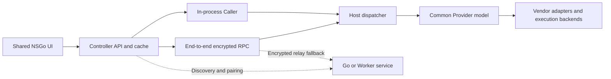

# Architecture standards

## Responsibilities and sources of truth

The controller owns interaction and local cache. The controlled host runs Agent adapters and execution. The device service provides discovery, pairing, signaling and encrypted relay; it does not run Agents or store conversation plaintext.

| Layer                  | Source                                                           | Owns                                                              |
| ---------------------- | ---------------------------------------------------------------- | ----------------------------------------------------------------- |
| Presentation           | `clients/nsgo/hubui`                                             | Layout, interaction, view state, controller-side grouping         |
| Controller application | `internal/clienthub`, `clients/nsgo/webapi`                      | Paired identity, connections, cache and RPC                       |
| Host application       | `internal/host`, `internal/app`                                  | Configuration, authorization, lifecycle, Provider composition     |
| Business model         | `internal/control`, `internal/provider`                          | Dispatch, sessions, messages, approvals, capabilities             |
| Agent adapters         | `internal/codex`, `internal/agents`                              | Vendor protocols, processes, local session access                 |
| Transport              | `internal/remote`, `internal/transport`, `internal/connectivity` | Encryption, active paths, frame scheduling, probes, retry budgets |
| Device service         | `internal/deviceservice`, `packages/worker-core`                 | The common public service contract                                |
| Persistence            | `internal/store` and cache adapters                              | Transactions, permissions, ownership and bounded caches           |

Presentation does not own Agent processes, database connections or vendor schema interpretation. Providers do not import UI or branch on the service runtime. Services route ciphertext without interpreting tool output. Compose dependencies at the application boundary.

## Shared UI and alternative services

Desktop, mobile and browsers share the NSGo controller; native and Web adapters express capability differences without copying pages or state machines. Next.js/Fumadocs serves the separately built official website.

Go uses SQLite, HTTP/WebSocket and optional integrated TCP/UDP probes. Worker uses D1, Durable Objects and platform bindings. Align external behavior, not table layouts or implementation lines; see [service parity](service-parity.md). Both self-hosting options remain complete and account-free. Their packages include the console and service; marketing and docs are published separately.

## Lifecycle and state transitions

Separate page, connection-attempt, established-connection, read-request and Agent-execution lifetimes. A remote timeout or phone disconnect must not implicitly stop a local Agent task. Explicit interruption and shutdown of a ReignHub-owned executor are distinct events.

Synchronization belongs to the application lifetime on every platform, not
window, activity or tab visibility. Backgrounding retains directory reads,
selected-session watch, approval reads, connection recovery and the bounded
snapshot writer. NSGo's background lifecycle includes window occlusion on macOS;
it is not proof of a lost connection. Android's foreground service requests OS
protection but is not a prerequisite for synchronization: denial or service loss
must not cancel healthy work while the process can still run.

The OS/browser may freeze execution, drop transports or terminate the process.
Returning to the foreground fences stale directory responses and performs one
coalesced history reconciliation, even with a valid replay cursor. Retain a
healthy watch and reconnect only after actual transport loss; restore a missing
watch without duplicating an initial history read. Never replay a write or reset
a draft on visibility changes. Existing bounded read/retry policies still apply
in the background. Quitting the application cancels its owned work; visibility
does not keep the screen awake or override OS background limits.

Agent integrations default enabled. The host persists explicit choices in
`Config.AgentEnabled`; missing keys mean enabled, and unavailable integrations
remain visible for installation/setup guidance. Each `AutoConnector` has its own
cancellable setup budget and retry loop, independent of the device service and
other Agents. Automatic setup never sends a prompt, changes credentials or
restarts an external application. One Codex Provider attaches to the existing local IPC service when installed;
App, CLI and VS Code creation sources share this integration. Readiness depends
on the IPC connection and private reader, not a desktop App process. ACP/Pi presets may
initialize their owned protocol process when installed and configured.

The local-only `host.agent.enabled` action changes this preference. The dispatcher
decorates the same Provider status for local and remote callers and rejects new
calls while disabled. Disabling cancels pending automatic setup, but does not
terminate external Apps or already accepted Agent tasks; existing caches remain
readable. Re-enabling resumes automatic attachment. Configuration and disablement
are not remote pairing permissions, and remote callers cannot change them.

Bound connection setup and individual requests; established connections and subscriptions need independent cancellation, liveness and cleanup. Bound queues, event logs, reassembly and concurrency. Cancel obsolete reads, and check context, device/session identity and generation before publishing results. UI state belongs to the UI loop; I/O and parsing run outside it.

Initial history, live watch and approvals progress independently. Publish history progressively in order. Provider discovery is availability metadata, not directory deletion authority. Persist first directory pages immediately and load them independently of current Provider discovery; replace a Provider directory only after successful complete reconciliation. Offline or failed reconciliation never commits an empty directory.

Selected conversations update through live notifications. Healthy heartbeats
and application ticks do not periodically refetch history. Restore cached
content/cursors immediately, then independently revalidate once when opening a
session without a verified read in this process. Stream reset/invalidation,
completion, explicit refresh, foreground return and subscription errors trigger
reconciliation. Failed subscriptions reuse their existing read backoff rather
than hiding readable persisted history. Coalesce in-flight snapshots, retain
history backoff and keep live deltas, approvals, drafts and navigation independent.

Directory refresh reads only Providers currently marked ready. A history capability
does not authorize requests to an unavailable Provider. Preserve its cached
sessions and recheck availability on subsequent discovery; synchronization resumes
when the Provider becomes ready. Scope actual directory errors to the Provider.

Persist received content with its applied cursor; a cursor must never acknowledge missing content. Rebuild only the affected baseline after replay-window loss. Isolate session failures with their own backoff.

The current Provider's transcript and ordered turn lifecycle events own execution
status. A cached terminal status cannot veto a current running snapshot or an
explicit running turn event for the same ID. Reconcile snapshot boundaries and
replay newer events before merging, so delayed history cannot undo a completion.
Late item/text deltas alone cannot reopen a terminal turn. Directory activity is
separate metadata and is not proof that the selected transcript is synchronized.

## Provider boundary and session metadata

Normalize vendor data into `Session`, `Turn`, `Item`, `Approval` and implemented `Capabilities` at the adapter boundary. Do not forward raw notifications, private reasoning or tool output as conversation text.

The host supplies `projectDir`, optional opaque `projectKey`, actual execution directory `cwd`, and creation/update timestamps in Unix milliseconds. Separate `recencyAt` records
the latest user submission or successful reply completion; metadata and streaming
updates must not advance it. Missing timing stays unknown. The same boundary
metadata travels in session summaries, turns and turn events. Controllers group matching repository project keys across devices, falling back to device plus `projectDir || cwd`. Names and vendor project IDs are not directory identity. A controller must not inspect its own filesystem to infer a remote project. Explicit project roots and worktree resolution follow the [Provider reference](../platform/agent-providers.md).

Document vendor-specific discovery, ownership transfer, local protocols and backend selection beside the relevant Provider code.

## Local and remote environments

`control.Caller` is the controller execution boundary. Native composition attaches the
application-owned `app.Embedded` runtime to `clienthub.Hub` as `local`; remote
connections implement the same interface through authenticated encrypted RPC.
Both routes share `Dispatcher.HandleRequest`, Provider dispatch, mutation ordering,
durable execution receipts, directory reconciliation and controller caches.
`HandleRemote` rejects local administration before entering the shared dispatcher.
Closing a controller or disconnecting a peer never closes the local runtime.
The local environment is ready independently of service registration, pairing,
account policy and remote network status. Mobile and browser controllers have no
local executable environment.

Each known environment has its own cached directory, cancellation scope and refresh
generation in `hubui/catalogue.go`. The landing sidebar starts all directories
without choosing a device. Saved valid grants resume once on entry; an initial
failed resume keeps cache available and offers an explicit retry. Established
connections continue the existing recovery/backoff policy. Manual disconnect
persists disabled auto-resume. Refresh and navigation never replay writes.

A provider's first page can appear before its complete reconciliation. Slow disk
cache fills only missing entries for providers without a completed live scan, so
unavailable Agents remain visible without resurrecting deleted sessions. Late
callbacks are fenced by environment instance and generation. Navigation changes
only the selected execution route and its transcript subscription, not directory
lifetimes. Session identity, drafts, pins and list keys include environment,
Provider and session IDs; deduplication never crosses environments. Pin, grouping
and tree expansion preferences are controller-local.

## Controller drafts and navigation

The controller owns its last visited session and unsent composer drafts. These
are local UI data, separate from Agent queues and outgoing delivery records.
[draft_persistence.go](../../clients/nsgo/hubui/draft_persistence.go) restores
the last route after a matching cached/live catalogue entry arrives, without
overriding subsequent user navigation. Small route and sidebar preferences use
NSGo storage; text/model/attachment drafts use the existing native controller
SQLite database or browser IndexedDB.

The local `client.draft.get/put` adapter calls share
[composerdraft](../../pkg/composerdraft/store.go). They are never forwarded to an
Agent or public service, so neither Go device-service nor Worker wire contracts
change. Keys include device, Provider and session. Attachment bytes are durable,
not temporary paths or entries in the evictable download cache. Write immutable
bytes before committing references, verify hashes when reading, and collect
unreferenced bytes after a successful update. Enforce the composer's 16-file,
50 MiB/file and 100 MiB/draft limits; text is bounded at 4 MiB.

One serialized writer coalesces edits for 150 ms off the UI loop; text edits do
not rewrite unchanged attachment bytes. An explicit storage retry never retries
an Agent message. Restoration is asynchronous, preserves stored data on failure,
and cannot replace another route or a removed draft. Restored attachments are
uploaded through the existing bounded upload queue when the session reconnects;
the user still decides when to send. Session removal clears its draft, and device
forget drains/gates pending writes before deleting that device's drafts. Clearing
download caches does not delete unsent attachments.

Normal shutdown drains pending drafts within the platform quit budget. Browser
page hiding flushes but must not cancel the controller's lifetime. A forced
termination, browser storage eviction or failed storage write can still lose
uncommitted edits; do not promise crash-proof preservation of the final keystroke.
Use isolated restart, delayed-write, failure/retry and attachment-integrity tests;
never operate real Agent conversations as persistence fixtures.

## Authorization and recovery

A host becomes remotely ready only after obtaining a valid service identity and authorization public key. Failed discovery must remain retryable; public-STUN defaults cannot substitute for missing trust configuration. Preserve service identity and signing keys across restarts.

Local pairing permission, signed service leases and optional commercial policy are separate boundaries. Validate authorization on direct and relay paths. Distinguish network failure, expired authorization and unavailable Agent capabilities; account-free deployments must not suggest signing in to fix ordinary network errors.

The host records the time it receives the local Accept action and persists it with the controller grant. Password-based approval records the time the host accepts the request automatically. Local `host.info` exposes that timestamp. The controller list shows the latest approvals first and displays their times in the local time zone. Existing grants without an approval timestamp follow dated grants, and the controller ID breaks ties.

Record cross-cutting changes in [decisions](decisions.md), including lifecycle, persistence, runtime and verification effects. Internal testing permits direct protocol/cache redesign; identity preservation and failure recovery remain required.
