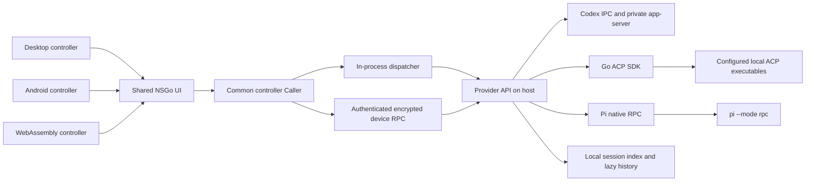

# Agent provider design

Reference reviewed: [T3 Code](https://github.com/pingdotgg/t3code/tree/295a0a7332aa1b0cc2f737dae71bd5e607a6ebb9), 2026-11-16. Launch entries for Cursor, Muse, Gemini and Claude were also checked against the [official ACP Registry](https://cdn.agentclientprotocol.com/registry/v1/latest/registry.json).

## What we adopt

| T3 Code design                                     | ReignHub application                                                                                                                                  |
| -------------------------------------------------- | ----------------------------------------------------------------------------------------------------------------------------------------------------- |
| Driver metadata separate from provider instances   | Agent presets plus stable, configurable instance IDs. Each instance has an independent runtime map and event log.                                     |
| Native adapters emit shared domain events          | Codex, ACP and Pi emit the existing Provider sessions, turns, items, approvals and streaming events. Native and Web controllers keep one NSGo UI.     |
| ACP protocol layer shared across compatible agents | Use `coder/acp-go-sdk`, not separate JSON-RPC implementations per brand. Negotiate ACP v1; do not advertise v2 preview support.                       |
| Models and capabilities belong to the live runtime | Read ACP prompt capabilities and per-session config; preserve Pi provider/model identity as a JSON pair. Unsupported steering is disabled.            |
| Native session identity separate from app identity | Random ReignHub IDs for owned conversations; deterministic provider/native ID hashes for imported ACP sessions. Persist the native reference locally. |
| Native discovery is distinct from message loading  | Discover ACP session metadata at most once a minute; only restore history when opened. Existing controller caches remain local-first.                 |
| Long-running work belongs to the host              | Prompt goroutines use host lifetime, not the controller RPC context. A remote disconnect does not cancel the task.                                    |
| Agent-owned permissions are surfaced explicitly    | Exact ACP option IDs; never reinterpret “always” as a one-time grant. Pi non-read-only tool hook uses its extension confirmation API.                 |

Sources: [driver and instances](https://github.com/pingdotgg/t3code/blob/295a0a7332aa1b0cc2f737dae71bd5e607a6ebb9/packages/provider-core/src/server/driver.ts), [provider boundary](https://github.com/pingdotgg/t3code/blob/295a0a7332aa1b0cc2f737dae71bd5e607a6ebb9/packages/provider-core/src/server/ProviderAdapter.ts), [built-in drivers](https://github.com/pingdotgg/t3code/blob/295a0a7332aa1b0cc2f737dae71bd5e607a6ebb9/apps/server/src/provider/builtInDrivers.ts), [ACP behavior](https://github.com/pingdotgg/t3code/blob/295a0a7332aa1b0cc2f737dae71bd5e607a6ebb9/docs/user/providers-acp.md), [Pi RPC framing](https://github.com/pingdotgg/t3code/blob/295a0a7332aa1b0cc2f737dae71bd5e607a6ebb9/packages/provider-pi/src/server/rpc.ts).

## Runtime boundary

No change to Worker signaling, pairing, relay or policy interfaces is needed. The private service consumes the same provider metadata through the public transport boundary. Executables, arguments and environment values are local host configuration, never remote session parameters. `host.*` remains blocked by `HandleRemote`.

## Transport coverage

Codex uses one Provider for App, CLI and VS Code sessions, routing writes to the current IPC owner and using a private app-server for reads and new sessions. See the [Codex reference](../../internal/codex/README.md). Claude Code, Cursor, OpenCode, Grok Build, Antigravity, Kiro, Muse Code, fx, DeepSeek Harness and Gemini CLI use ACP launch presets. Pi uses native RPC and an injected local approval extension.

T3 Code uses dedicated SDKs for Cursor and Muse. We use their currently published official ACP entry points (`cursor-agent acp`, `muse acp` with `MUSE_EXPERIMENTAL_ACP=on`) to keep the host free of an additional JavaScript SDK runtime and reuse the same protocol and UI. This covers portable ACP features, not every SDK-specific T3 feature.

Local command configuration takes effect after restarting ReignHub. The dispatcher provider map stays immutable after startup, avoiding concurrent map mutation while paired clients issue requests. Multiple instance IDs do not imply isolated Agent credentials; use the Agent's own home/environment settings for that.

Integrations default enabled. `Status.enabled` reports the host's persisted local
choice independently of installation and readiness; disabled Providers report
`state: "disabled"` and reject new calls. Each installed/configured adapter
initializes independently without sending a prompt. The local-only
`host.agent.enabled` request takes `provider` and `enabled`; disabling cancels
pending setup without interrupting already accepted tasks or deleting history.
Home and settings share a switch per Agent, disabled when unavailable, plus
installation or setup guidance. Readiness does not require a manual Enable flow.
See [lifecycle](../engineering/architecture.md).

This adds endpoint metadata and a local host action, not a public service route.
Both `internal/relay` and `packages/worker-core/src/room.ts` continue forwarding
opaque encrypted frames and need no implementation edit. The Go status and
TypeScript Provider declaration remain aligned.

## Project identity across Agents

All session metadata carries `projectDir` (the project used for grouping) and
`cwd` (the actual execution directory). The host normalizes `projectDir` once at
the common API/sync boundary for every provider: an adapter's explicit project
directory wins, followed by its native project root, then the Git repository's
main directory for linked worktrees, and finally the working directory. Git and
symlink resolution use the host filesystem without launching a Git subprocess.

Controllers group by optional `projectKey`, otherwise device plus
`projectDir || cwd`, independently of Agent or native project ID. Codex, Claude Code, Pi and future ACP sessions in the same project
therefore share a group while keeping their own provider/session routes and
execution directories. Titles are display metadata, never identity; unrelated
directories called `gopeed` remain separate. An explicitly assigned standalone
worktree uses its own project directory. Two native project IDs pointing to the
same directory intentionally share one group.

The same metadata is returned in the first session page, incremental catalogue,
new-session response and transcript snapshot, and remains available offline in
the controller's existing cache. No Agent-specific grouping or filesystem
inspection runs on the controller.

The host also computes an optional opaque `projectKey` from a network Git origin
and repository-relative project directory. Equivalent SSH/HTTPS origins merge
across machines; origin credentials, query strings and fragments never leave the
host. Nonstandard ports remain distinct. No network access or Git process is used.
Unversioned/local-only origins fall back to device-scoped paths. Explicit separate
worktree roots outside the main repository retain device-local identity.

Optional `project.roots` retains an Agent's complete configured directory list;
`project.root` remains its primary grouping root. Optional `gitInfo` describes
the session's actual `cwd`: `branch` is a local branch name, `commit` is a full
detached-HEAD object ID, and `repository` is a credential-free host/path display
name. The shared workspace resolver reads bounded Git metadata files once per
checkout per request, using a linked worktree's own HEAD and its common config.
It performs no Git subprocess, network request, write or hover-triggered polling.
Missing/unreadable data is omitted; no default branch is invented. A later
catalogue request picks up branch changes without changing conversation timing.
First pages, deltas and transcript responses use the same host enrichment;
controllers keep the received metadata in their existing caches. Remote hosts
must be updated to supply these optional fields. Go/Worker relays still forward
opaque ciphertext and need no service changes.

`createdAt` and `updatedAt` are Unix milliseconds. Codex app-server seconds are
normalized; IPC dates are decoded before normalization. ReignHub-owned ACP/Pi
sessions record creation when created. Imported Agents that do not supply creation
time use zero (unknown); controllers sort them last with stable identity order,
never by last update. Metadata flows through the same local and remote boundaries.

`recencyAt` is a separate fixed conversation boundary: the later of a user
submission and successful reply completion. ReignHub-owned ACP/Pi sessions
record these events and persist the same value in summaries and turns. Imported
history without recorded boundaries remains unknown; neither native metadata
`updatedAt` nor synchronization time is a substitute. Controllers fall back to
creation time and a stable identity tie-breaker.

Activity summaries must reflect the executor that actually owns the session.
Codex directory reads combine persisted metadata with bounded read-only IPC
owner state; the private reader's `notLoaded` does not describe another executor.
Unknown state remains unknown. The [Codex adapter reference](../../internal/codex/README.md)
owns lock probing, subscription bounds and runtime-state normalization. Local
and remote controllers consume the same `status`/`activeTurnId` fields.

## Persistence and recovery

Managed Providers store session metadata and dirty turn and message rows in the application database. A transaction commits those rows and their stream checkpoint together. Directory restoration reads summaries, and transcript requests read bounded pages. A completed idle session releases its in-memory turns.

ReignHub-owned sessions resume with the stored native session ID or Pi session file. ACP `session/load` replay becomes canonical history. Native sessions are listed only when both listing and loading are advertised. SDK/tool reasoning and raw tool output are not exposed as user-facing messages.

## Composer settings

Permission and reasoning choices belong to the selected session. Codex offers
the built-in read-only, workspace approval, automatic review and full-access
presets permitted by its permission profiles and managed policy. Reasoning
choices come from the selected model. Writes follow the current IPC owner or
the shared app-server. The permission control shows the active session preset
or custom profile reported by its owner, including when managed policy
restricts the available choices. An IPC snapshot or a shared-server resume
refreshes the control on first entry. Until the host reports a policy, the
control shows that its permission has yet to sync.

ACP uses session configuration options and legacy session modes reported by the
Agent. The option IDs and selections come from the native session. Pi exposes the
current model’s thinking levels and retains its native tool approval extension.
The controller reads choices again after a change and hides controls that the
Agent or selected model does not offer. The controller confirms a switch to full
access for the current session and device. ACP adapters mark recognized native
permission-bypass choices in mode and permission selectors. ACP reasoning controls carry the semantic kind `effort` alongside their native write ID. The model catalogue marks image input only when the individual model advertises that modality.

## Session removal

The optional `provider.SessionRemover` implements `session.remove` for both
in-process and remote callers. `capabilities.sessionRemoval` advertises the
implemented outcome: `archive`, `detach` or `delete`; omission means unsupported.
The controller uses one Remove session action and describes that outcome before
submission. Providers reject running, waiting and restoring sessions. Removal
must never silently cancel independent Agent execution.

Codex uses `thread/read` metadata to reject active work, then the supported
`thread/archive` request with the exact `threadId`. The installed Codex
`app-server generate-json-schema` contract was checked for these parameters.
No writer takeover or private history-file deletion is used. ACP v1 and Pi do not
provide a portable native deletion operation: their shared Provider implements
`detach`, persisting a per-instance exclusion in `removed_sessions`, retaining native
history, and preventing native discovery from reimporting the removed entry.
An idle ReignHub-owned runtime is closed after successful persistence.

Removal goes through normal mutation ordering and durable receipts. A lost Codex
archive acknowledgement is `WRITE_OUTCOME_UNKNOWN`; neither the controller nor
transport retries it. Controller-local cache fences survive restart until a
complete directory has observed the entry's absence. Successful removal updates
all sidebar sections and clears its pin without changing another conversation
or draft. After an uncertain result, a fresh complete directory confirming absence
also closes the removed conversation and its pending confirmation; partial reads
or an entry that remains present never authorize replay. Service pairing/relay contracts are unchanged; Go and Worker continue
to forward encrypted frames without understanding Agent operations.

## Validation and scope

Subprocess fixtures exercise actual ACP JSON-RPC and Pi JSONL framing, fragmented writes, Unicode text offsets, per-session model options, exact permission choices, cancellation, native history replay, process exit, lazy discovery and persistence. Tests also verify that ending a controller request does not end an Agent prompt.

Agent packages and authenticated model accounts are not installed by these tests. Each vendor's current authenticated executable still requires live integration testing in its target environment. Client-side ACP filesystem/terminal APIs, ACP v2 preview features, T3-specific checkpoints/worktrees/MCP delegation and vendor-specific SDK features are outside this implementation's advertised capabilities.

## Question forms

`Approval.questions` optionally carries a normalized list of opaque `id`,
`question`, optional `header`, `isSecret` and `options` (label/description) fields.
`allowSkip` permits dismissing or partially answering an optional form. `decide`
uses `decision: "input"` with `answers[id].answers` containing the chosen label or
custom text; `decision: "skip"` carries no answers. The Provider validates the
request and translates it to its native operation. Only Providers that understand
these semantics advertise forms; existing ACP/Pi permissions remain unchanged.

The dispatcher scopes approval reads and decisions to the requested session, and
the controller also filters incoming approvals to the selected session. Local
and remote controllers share the same form and dispatcher. Codex's async metadata
and synchronous requests use different native transports; see its
[owning reference](../../internal/codex/README.md#questions-and-answers).

These are encrypted endpoint payloads, not new public service APIs. Inspected
`internal/relay/relay.go` and `packages/worker-core/src/room.ts` continue forwarding
opaque frames and need no changes. Both host Provider and controller must be
updated to display newly normalized question metadata.
